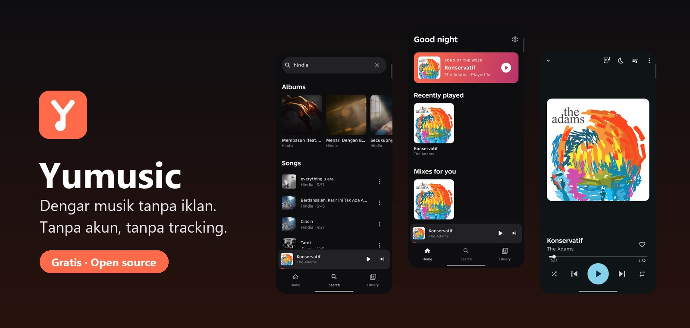
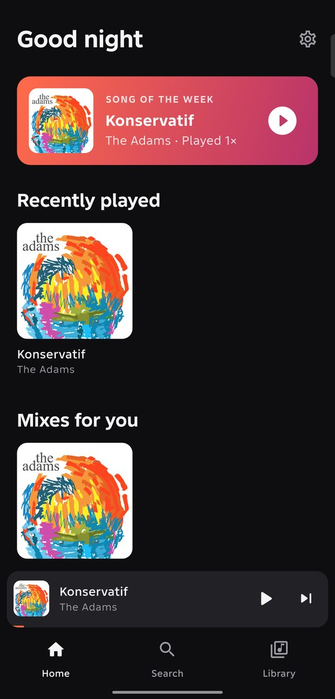
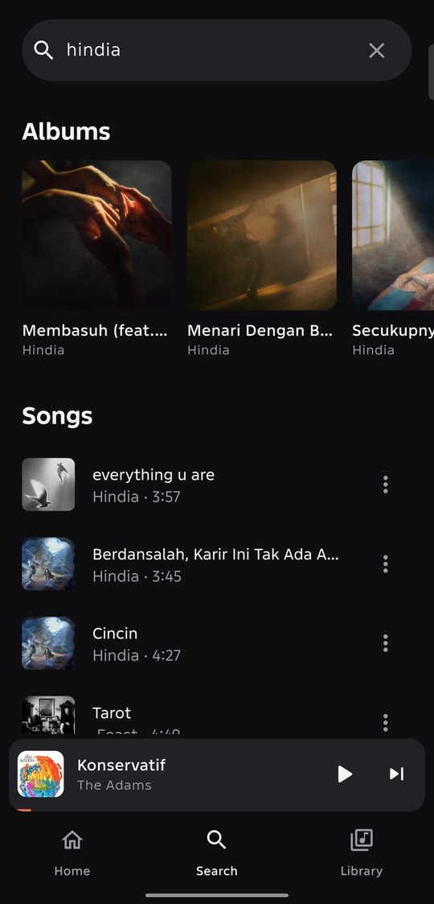
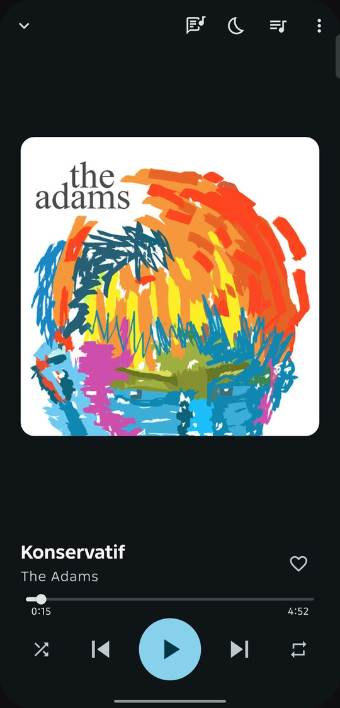
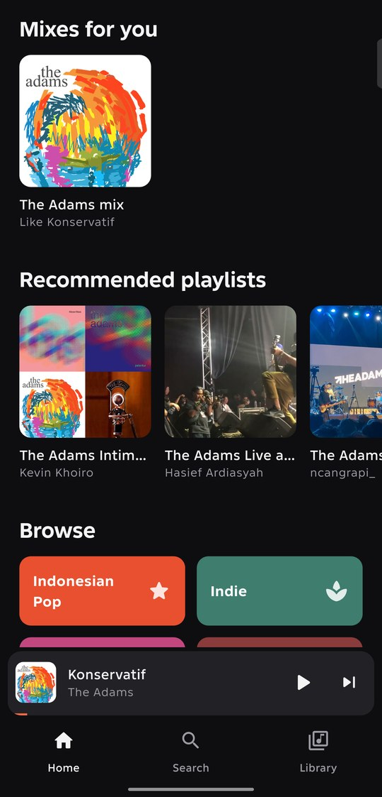
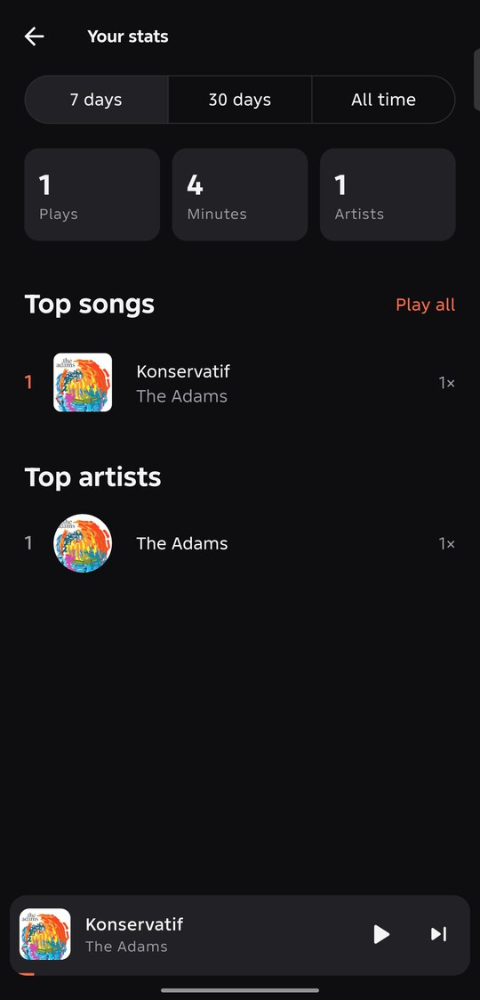
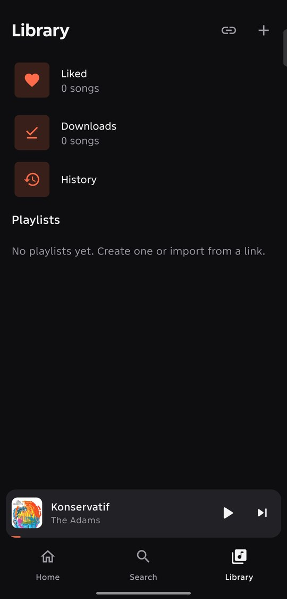

<div align="center">



[](../../releases/latest)
[](#download)
[](LICENSE)

[**Download**](#download) · [**Fitur**](#fitur) · [**Screenshot**](#screenshot) · [**Disclaimer**](#disclaimer) · [**Build**](#build)

</div>

> [!IMPORTANT]
> Yumusic tidak berafiliasi dengan atau didukung oleh YouTube maupun Google. Lagu diambil dari YouTube Music lewat [NewPipe Extractor](https://github.com/TeamNewPipe/NewPipeExtractor), langsung oleh HP kamu sendiri. Tidak ada server Yumusic di antaranya, dan tidak ada data yang dikirim ke mana pun selain ke YouTube dan [LRCLIB](https://lrclib.net) (untuk lirik).

---

<h2 align="center"><a id="screenshot"></a>Screenshot</h2>

<p align="center">
  
  
  
</p>
<p align="center">
  
  
  
</p>

---

<h2 align="center"><a id="fitur"></a>Fitur</h2>

| Fitur | Keterangan |
|---|---|
| Cari dan putar | Lagu dan album dari katalog YouTube Music. Versi ganda lagu yang sama disembunyikan, dan album yang cocok dengan semua kata pencarian tampil paling depan. Tiga hasil teratas disiapkan selagi kamu melihat daftar, jadi tap langsung main. |
| Radio dari lagu pilihan | Lagu dari pencarian diputar sendiri, lalu antrean diisi lagu yang mirip (mix YouTube Music lagu itu), bukan hasil pencarian di bawahnya. Tiap artis dibatasi 4 lagu supaya radio tidak jadi satu artis saja. |
| Home | Lagu minggu ini, baru diputar, mix untuk kamu (satu per artis yang sering kamu dengar), playlist rekomendasi, paling sering diputar, dan katalog 16 genre dan suasana: Pop Indonesia, Indie, Rock, Hip-Hop, K-Pop, Jazz, Dangdut, Lo-fi, Galau, Fokus, dan lainnya. |
| Album dan playlist | Buka album atau playlist YouTube Music, putar semua, acak, atau simpan ke Library. Playlist YouTube publik bisa diimpor dari link-nya. |
| Statistik kamu | Lagu dan artis teratas, jumlah putar, dan perkiraan menit mendengarkan, untuk 7 hari, 30 hari, atau semua waktu. Lagu dihitung setelah didengar 30 detik, jadi yang langsung di-skip tidak ikut. Semuanya tersimpan di HP. |
| Sleep timer | 5, 15, 30, 45 menit, 1 jam, atau di akhir lagu. Volume dikecilkan perlahan di 30 detik terakhir supaya tidak berhenti mendadak saat kamu tertidur. |
| Main di background | Tetap jalan saat layar mati. Kontrol dari notifikasi, lock screen, atau tombol headset Bluetooth. Lagu yang gagal dimuat langsung dilewati. |
| Antrean | Putar berikutnya, tambah ke antrean, geser untuk mengubah urutan, hapus, acak, ulang satu atau semua. Saat antrean habis, lagu yang mirip diputar otomatis. Antrean dan posisi lagu tetap sama setelah app ditutup. |
| Library | Playlist sendiri, lagu disukai, dan riwayat 100 lagu terakhir. |
| Offline | Simpan lagu ke HP dan dengarkan tanpa internet. Bisa diatur hanya download di Wi-Fi. |
| Lirik | Dari [LRCLIB](https://lrclib.net): ikut bergulir sesuai lagu bila tersedia, lirik biasa bila tidak. Tap sebuah baris untuk lompat ke bagian itu. |
| Kualitas audio | Rendah, sedang, atau tinggi, diatur terpisah untuk Wi-Fi dan data seluler. |
| Backup | Playlist, lagu disukai, riwayat, dan statistik dalam satu file JSON. Impor di HP baru; data digabung, tidak ada yang tertimpa atau ganda. |
| Tampilan | Terang, gelap, atau ikut HP. Warna layar Now Playing mengikuti cover lagu. |
| Bahasa | Indonesia dan Inggris. |
| Diagnosa | Settings → Diagnosa pemutaran menguji pencarian, URL stream, dan pemutar satu per satu, dengan pesan error lengkap yang bisa disalin. |

---

<h2 align="center"><a id="download"></a>Download</h2>

1. Di HP, buka [Releases](../../releases) dan download `yumusic-vX.Y.Z-arm64-v8a.apk` yang terbaru. Untuk HP lama 32-bit, pilih yang `armeabi-v7a`.
2. Buka file-nya. Android akan bertanya apakah browser atau file manager boleh memasang aplikasi; izinkan sekali.
3. Kalau musik berhenti sendiri saat layar mati (sering di Xiaomi, Oppo, Vivo, Realme), buka Settings → *Musik berhenti sendiri?* di app untuk panduan mematikan optimasi baterai.

Butuh Android 8 atau lebih baru.

Untuk update otomatis tanpa toko aplikasi, tambahkan link repo ini ke [Obtainium](https://github.com/ImranR98/Obtainium).

> [!NOTE]
> YouTube mengubah sistemnya dari waktu ke waktu. Kalau pencarian atau pemutaran tiba-tiba rusak, biasanya tetap rusak sampai NewPipe Extractor diperbaiki dan rilis Yumusic baru keluar.

---

<h2 align="center"><a id="disclaimer"></a>Disclaimer</h2>

- **Gratis dan non-komersial.** Yumusic adalah software open source untuk pemakaian pribadi dan belajar. Tidak ada iklan, fitur berbayar, langganan, atau permintaan donasi di dalam app.
- **Klien, bukan layanan.** Yumusic menampilkan konten yang sudah dibuka untuk publik oleh YouTube dan YouTube Music, mirip seperti browser. Semuanya jalan di HP kamu, tanpa akun dan tanpa mengumpulkan data pribadi.
- **Tidak meng-hosting apa pun.** Yumusic tidak menyimpan, mengunggah, atau menyebarkan musik atau video. Lagu di-stream dari server YouTube dan tetap milik pemegang hak ciptanya. Lagu yang kamu download hanya ada di HP kamu.
- **Dukung musisinya.** Kalau bisa, berlangganan [YouTube Music Premium](https://www.youtube.com/musicpremium) atau [Spotify Premium](https://www.spotify.com/premium/), beli musiknya, atau datang ke konsernya. Yumusic proyek hobi dan tidak menggantikan semua itu.
- **Tidak berafiliasi.** Tidak berafiliasi dengan, didanai, diizinkan, atau didukung oleh YouTube, Google LLC, Spotify AB, LRCLIB, atau afiliasi mereka. Semua merek dagang milik pemiliknya masing-masing.
- **Apa adanya.** Yumusic diberikan tanpa jaminan apa pun, seperti tertulis di [lisensi GPL-3.0](LICENSE). Kamu bertanggung jawab atas cara kamu memakainya, atas ketentuan layanan yang terhubung, dan atas hukum di negaramu.

---

## Build

Butuh Flutter SDK (stable), Android SDK command-line tools, dan JDK 17 atau lebih baru.

```sh
flutter pub get
flutter run --release                  # ke HP yang tersambung
flutter build apk --release --split-per-abi --target-platform android-arm,android-arm64
flutter test                           # tes unit
```

APK ada di `build/app/outputs/flutter-apk/`. Setelah mengubah tabel database, buat ulang kode Drift dengan `flutter pub run build_runner build --delete-conflicting-outputs`. Akses ke YouTube hanya bisa dicoba di perangkat Android, karena NewPipe Extractor jalan di sisi Android.

Tanpa kunci rilis, build ditandatangani kunci debug. Kunci rilis dibaca dari `android/key.properties`, yang tidak ikut masuk repo:

```properties
storeFile=release.jks
storePassword=...
keyAlias=yumusic
keyPassword=...
```

### Rilis

Push tag versi (`git tag v0.2.0 && git push --tags`), lalu GitHub Actions menjalankan tes, membangun APK per ABI, dan menaruhnya di GitHub Releases. Isi secret repo `KEYSTORE_BASE64` (isi `release.jks` dalam base64), `KEYSTORE_PASSWORD`, `KEY_ALIAS`, dan `KEY_PASSWORD`, supaya setiap rilis ditandatangani kunci yang sama. Simpan keystore baik-baik: kalau hilang, pengguna lama harus uninstall dulu untuk update.

Kalau lagu tidak bisa diputar karena YouTube berubah, perbaikannya hampir selalu cukup dengan menaikkan versi NewPipe Extractor di `android/app/build.gradle.kts` lalu merilis patch.

### Struktur kode

| Folder | Isi |
| --- | --- |
| `lib/source/` | Akses YouTube dan LRCLIB. `MusicSource` adalah interface-nya, `NewPipeSource` implementasinya |
| `android/.../NewPipeBridge.kt` | Jembatan ke NewPipe Extractor: pencarian lagu, album, dan playlist, URL stream, lagu terkait |
| `lib/player/` | Audio handler (antrean, radio, sleep timer, kontrol media) dan download |
| `lib/data/` | Database Drift, statistik, rekomendasi, peringkat pencarian, katalog genre |
| `lib/ui/` | Layar dan widget |
| `lib/l10n/` | Teks Indonesia dan Inggris |
| `tool/` | Pembuat ikon app dan gambar README |

## Kredit

- [NewPipe Extractor](https://github.com/TeamNewPipe/NewPipeExtractor) (GPL-3.0) untuk membaca YouTube
- [just_audio](https://pub.dev/packages/just_audio) dan [Media3 / ExoPlayer](https://github.com/androidx/media) untuk pemutaran
- [audio_service](https://pub.dev/packages/audio_service) untuk pemutaran di background dan kontrol media
- [LRCLIB](https://lrclib.net) untuk lirik
- [Drift](https://drift.simonbinder.eu) untuk database lokal dan [Riverpod](https://riverpod.dev) untuk state
- [Spotifry](https://github.com/Alnyz/spotifry) (GPL-3.0), yang alur pengambilan stream dan radionya jadi acuan

## Lisensi

GPL-3.0, lihat [LICENSE](LICENSE). Yumusic berlisensi GPL-3.0 karena NewPipe Extractor yang dipakainya juga GPL-3.0.
